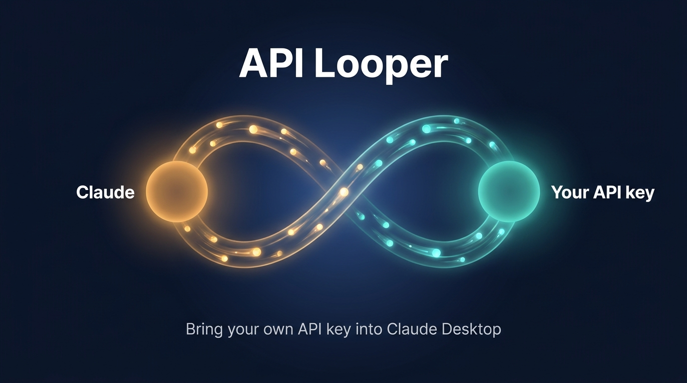

# API Looper

**Bring your own API key into Claude Desktop.**

Claude plans and reviews. The model on your own API key does the long drafting, rewriting and bulk work. Those tokens are billed to your API account, not your Claude plan.

Works with **Kimi (Moonshot)**, **OpenAI**, **OpenRouter**, **DeepSeek**, **Google Gemini**, the **Anthropic API**, or any OpenAI-compatible endpoint.

## What Claude gets

| Tool | What it does |
|---|---|
| `delegate_to_model` | Sends a self-contained task to your model and returns the answer, with the tokens used shown on every reply. |
| `list_models` | Lists the model IDs your key can use. |
| `token_usage` | Shows tokens sent through API Looper today, this month or all time, broken down by model. Tracked only on your computer. |
| `check_balance` | Reads your balance or spend straight from the provider (Kimi, DeepSeek, OpenRouter) and links to your billing dashboard. |

## Install

1. Download [`api-looper.mcpb`](https://github.com/youssefjalloul-inova/api-looper/raw/main/dist/api-looper.mcpb).
2. Double-click it. Claude Desktop opens the install screen.
3. Fill in:
   - **Provider**: `moonshot` (Kimi), `openai`, `openrouter`, `deepseek`, `gemini`, `anthropic` or `custom`
   - **API key**: stored in your system keychain by Claude Desktop
   - **Default model**: optional. Leave it blank and ask Claude to "list my models"
   - **Base URL**: only for `custom`, or to point Kimi at `https://api.moonshot.cn/v1`
   - **Monthly token cap**: optional limit. Delegation stops once it's reached
4. Enable it, then ask Claude something like:
   > Use my model to write 10 hook variations for this post, then pick the best 3.

## Seeing what you spend

- Ask Claude **"check my API balance"** or **"show my token usage this month"**.
- Every delegated reply ends with a line like `[Moonshot (Kimi) · kimi-k2 · 1,240 in / 860 out tokens · 4.2s]`.
- Your provider's dashboard has the full history. The usage log is in `~/.api-looper/usage.jsonl`.

Nothing is spent until Claude actually delegates a task, so if you see no spend yet, ask Claude to use your model for something.

## Good to know

- API Looper doesn't change the model Claude Desktop itself runs on. Your Claude chat stays on your Claude plan, and API Looper adds a second model Claude can hand work to.
- The delegated model only sees what Claude sends it, so Claude includes the full context in each task.

## Build from source

```bash
npm install
npm run pack   # creates api-looper.mcpb
```

## License

MIT
